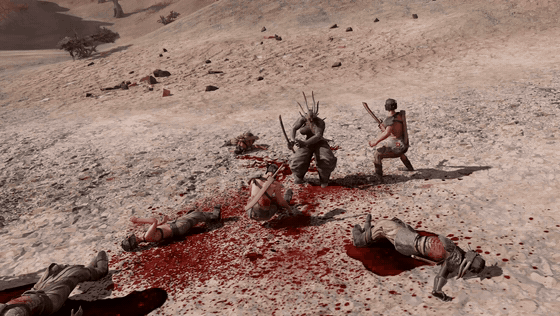

# PZA's SlowMo

One click (or **Shift+L**) puts Kenshi into slow motion. A slider sets how slow, from **0.10x to 0.60x** in 0.05 steps,
and it always lands exactly on 0.10, 0.50 and 0.60. Click again (or Shift+L) to go back to the speed you were running at.

Author: PZA. Licence: GPLv3 or later (KenshiLib is GPLv3). Needs RE_Kenshi.

## Use
- The small **Slow motion** window (Kenshi's own window style) sits next to Kenshi's speed buttons; drag it by its title.
  - The top button turns slow motion on and off.
  - `-` / slider / `+` set the slow speed. Changes apply at once and are saved to `PZASlowMo.ini`.
- **Shift+L** does the same as the top button. It's ignored while you type in a text box.
- Pressing one of Kenshi's own speed buttons (or F2-F4) while slow motion is on hands control back to Kenshi.
- Loading a save switches slow motion off.

## Settings (`PZASlowMo.ini`)
| Key | Default | What |
|---|---|---|
| `Speed` | 0.50 | The slow-motion speed (the slider saves it here). |
| `MinSpeed`, `MaxSpeed`, `SliderStep` | 0.10, 0.60, 0.05 | Slider range and step (0.01 - 0.99). |
| `Hotkey` | Shift+L | Toggle key. A bare letter gets Shift. `Off` = none. |
| `ShowWindow` | 1 | 0 = hotkey only. |
| `WindowX`, `WindowY` | -1 | Window position as a fraction of the screen; -1 = next to Kenshi's speed buttons. |
| `Popups` | 1 | An on-screen message when slow motion turns on or off. |
| `Language` | auto | Text language: `auto` follows Kenshi's own; `en`, `ru`, `zh`, `ja` choose (ru / zh / ja need Kenshi itself in that language: only then are its fonts loaded with those letters). |
| `HideWithUI`, `Collapsed`, `TinyX`, `TinyY`, `TinyAlpha` | | Saved by the window itself (F7 hiding, size, tiny-button position and opacity). |

## How it works
Kenshi's `GameWorld::setGameSpeed` takes any speed (it only compares against 0 for pause and the standard speeds), so the
plugin calls it with the slow speed and checks once that Kenshi reports the same value back. Speeds are kept in whole
hundredths, so the float Kenshi gets is exactly the float for 0.10 / 0.50 / 0.60. Every MyGUI call runs under an
exception guard; a fault switches the window off for the session and Shift+L keeps working.

## Build
VS2022 MSBuild `PZASlowMo.sln /t:Rebuild /p:Configuration=Release /p:Platform=x64` (toolset v100, VS2010, for Kenshi's
`std::string`). Needs `KenshiLib_Examples_deps`. Offline tests: `tests\build_test.bat` (the rules, `src/SlowCore.h`),
`tests\build_test_strings.bat` (language files, language choice, and every glyph and caption width against Kenshi's
own fonts: `tests/lang/check_lang.py`), `tests\fuzz\build_fuzz.bat` (the rules and the language-file parser).
Release: build with v100 from a folder whose path holds no personal name (the DLL keeps only its PDB file name), then
`python -I tools/make_release.py` (checks and stages the mod folder, the zip and the source zip).

## Install
Use the folder `tools/make_release.py` stages (`out/release/PZASlowMo-<version>/PZASlowMo/`): copy it into
`Kenshi\mods\` and enable the mod in the launcher. It holds the DLL, `RE_Kenshi.json`, `PZASlowMo.mod`,
`PZASlowMo.ini`, `lang\`, the licence and notices.

## v0.2.0

- The window hides when **F7** hides Kenshi's interface (`HideWithUI=1`), for clean screenshots.
- The **-** button collapses the window to its on/off button; **+** opens it again (remembered: `Collapsed`).
- A window title bar holding the keyboard (which blocked Space, F7 and the hotkeys) is given the keyboard back, and the log names the window.

## v0.2.1

- Three window sizes: **-** goes full -> compact (title + on/off) -> **tiny** (no frame: one small "slow 0.50x" button that turns slow motion on/off, and **+** beside it to open the full window). Remembered (`Collapsed=0/1/2`). The tiny buttons sit where the window first opens.

## v0.2.2

- "-" now goes straight from the full window to the **tiny** button (the compact step is gone: it looked squished and made tiny one click too far). "+" next to the tiny button opens the full window. **Double-clicking the tiny button opens it too** (its two clicks switch slow motion on and back off, so the speed is unchanged).

## v0.2.3

- **Hold Shift+L and tap + or -** (main row or numpad) to step the speed by 0.05 along the slider scale, with no window needed: works with F7 (hidden interface), for machinima. **Shift+L alone** still turns slow motion on/off, now on release; it does not toggle if you tapped + / - while holding it.

## v1.0.1

- **One Workshop item for both games:** the mod folder also carries PZA's SlowMo for Meitou 0.3.0 (`meitou.json`,
  `PZASlowMo.Meitou.dll`, `lang/meitou.*.txt`; source: https://github.com/PZA-Mods/PZAMeitouSlowMo). RE_Kenshi loads only
  `RE_Kenshi.json`'s DLL, Meitou only `meitou.json`'s. The RE_Kenshi plugin itself is unchanged apart from its version.

## v1.0.0

- **Languages:** English, Russian, Simplified Chinese, Japanese. Every caption, tooltip, help page and message goes through
  a string table (`src/StringList.h`; `dist/lang/ru.txt`, `zh.txt`, `ja.txt`, machine-drafted and marked so). The language
  follows Kenshi's own (`settings.cfg`); `Language=` in the ini overrides it. A missing or broken line shows English and is
  logged. Same loader and rules as LEAF's (`src/StringTable.h`).
- **Every caption fits:** the window is 40 px wider (inner 330) and the tiny button 120 px wide (was 96), so the widest
  text in any language (English "Slow motion: off (0.50x)", 235 px) fits its button.
- Windows version resource (`PZASlowMo.rc`: PZA, 1.0.0), `NOTICE.md`, `tools/make_release.py`.
